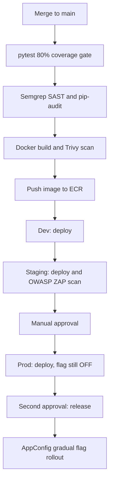
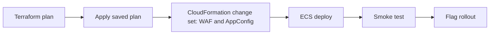
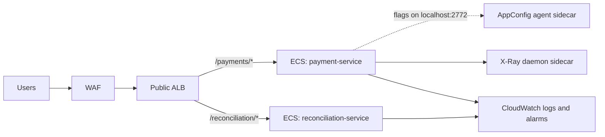

# Finance Indigo Compass: Secure ECS Delivery with Feature Flags

A release pipeline for two Python (FastAPI) services, a **payment service** and a **reconciliation service**, running on **AWS ECS Fargate**. A merge to `main` runs tests and security scans, then deploys through dev, staging and prod. Deploying code and **releasing a feature are separate steps**: new code ships with the feature flag OFF, and the flag is turned on later with a gradual rollout that rolls back automatically on errors.

> **Status:** personal portfolio project. The pipeline, Terraform, CloudFormation and services are written and validated locally. They have not been deployed to a live AWS account.

## Architecture

### 1. Release pipeline



### 2. What happens in each environment



### 3. Runtime



## Key design decisions

| Decision | How it works |
|---|---|
| **Deploy is not release** | The `new_payment_flow` flag is OFF when code is deployed. Prod has a second manual approval before the flag is rolled out. |
| **Gradual flag rollout** | AppConfig moves the flag in 20% linear steps. A CloudWatch 5xx alarm is attached to the AppConfig environment; if it fires, AppConfig reverts the flag. |
| **Fail-safe flags** | The payment service reads flags from the AppConfig agent. On any error it falls back to the safe default (flag OFF), so a flag outage never breaks payments. |
| **Automatic deploy rollback** | The ECS deployment circuit breaker and a deployment alarm roll back failed or error-producing releases. |
| **Build once, promote** | One image tag (`build-<id>`) moves through all environments. ECR tags are immutable. |
| **Shift-left security** | Semgrep (SAST), pip-audit (dependencies), Trivy (image) and OWASP ZAP (DAST on staging). |
| **Edge protection** | AWS WAF with AWS managed rule groups and a per-IP rate limit, deployed with CloudFormation. |
| **Reviewed infra changes** | Terraform: plan, then apply the saved plan. CloudFormation: a change set is created and executed, never a blind update. |
| **Least privilege** | Separate ECS execution and task roles. The task role only reads AppConfig and writes X-Ray. Tasks are in private subnets and accept traffic only from the ALB. |
| **Secrets** | Secrets Manager containers per service. Values are set outside Terraform so they never enter state. |

## Repository layout

```
azure-pipelines.yml            # CI + dev, staging and prod stages
templates/deploy-ecs.yml       # plan / apply / deploy / smoke test / flag rollout
services/
  payment-service/             # FastAPI, feature-flag client, tests, Dockerfile
  reconciliation-service/      # FastAPI, Decimal-based matching, tests, Dockerfile
flags/                         # feature flag documents per environment
infra/
  terraform/                   # VPC, ALB, ECS, IAM, ECR, alarms
    envs/                      # dev / staging / prod variable files
  cloudformation/              # edge.yaml (WAF + AppConfig) and per-env params
scripts/                       # deploy, smoke test, flag rollout, rollback helpers
```

## Try it locally

```bash
# Create a virtual environment and run the tests with the coverage gate
python3 -m venv .venv && source .venv/bin/activate
pip install -r requirements-dev.txt
pip install -r services/payment-service/requirements.txt -r services/reconciliation-service/requirements.txt
pytest --cov=services --cov-fail-under=80

# Validate the Terraform (no AWS account needed)
cd infra/terraform
terraform init -backend=false
terraform validate
```

## Rollback

| Situation | What happens |
|---|---|
| Tests or scans fail | Nothing is pushed. |
| New tasks fail health checks | The ECS circuit breaker rolls back to the previous task definition. |
| 5xx alarm during a deploy | The ECS deployment alarm rolls the deployment back. |
| 5xx alarm during a flag rollout | AppConfig reverts the flag automatically. |
| Smoke test fails | The stage fails and `rollback.sh` points the services at the previous image. |

## Known limits and what I would improve next

- The services have no X-Ray SDK instrumentation yet. The X-Ray daemon sidecar is provisioned, but traces need the SDK added.
- The ALB is plain HTTP by default for the demo. Set `certificate_arn` and `app_domain` to serve HTTPS with an HTTP redirect.
- Add a Grafana or CloudWatch dashboard for the golden signals.
- Add image signing (cosign) and verify signatures at deploy time.
